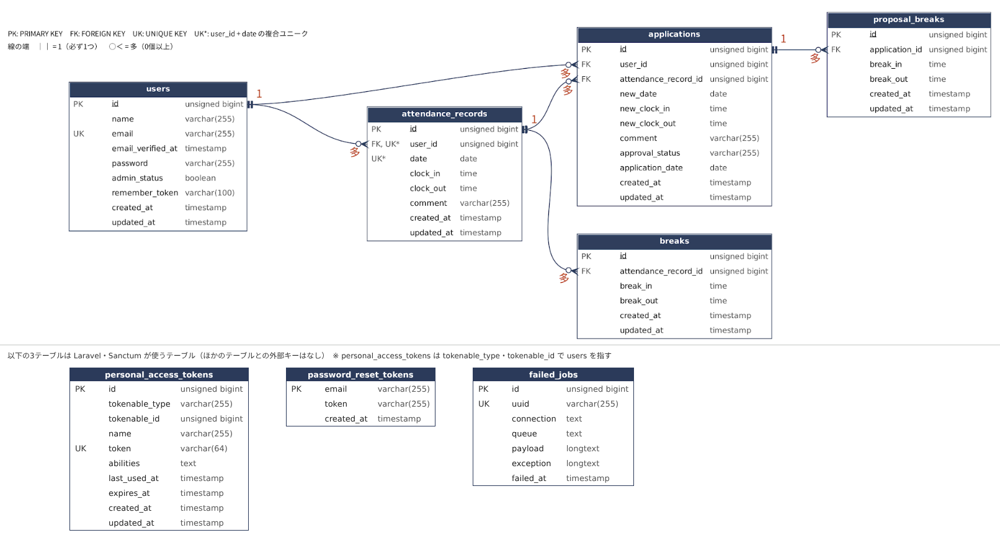

# 勤怠管理アプリ

一般ユーザーの打刻・勤怠確認・修正申請と、管理者による勤怠管理・申請承認ができる勤怠管理アプリです。

## 環境構築

### Docker ビルド
1. `git clone https://github.com/momo888-y/attendance-app.git`
2. `cd attendance-app`
3. 依存パッケージをインストール
   ```bash
   docker run --rm -u "$(id -u):$(id -g)" -v "$(pwd):/var/www/html" -w /var/www/html laravelsail/php82-composer:latest composer install --ignore-platform-reqs
   ```
4. `cp .env.example .env` を実行し、`.env` を以下のように設定
   ```
   DB_CONNECTION=mysql
   DB_HOST=mysql
   DB_PORT=3306
   DB_DATABASE=laravel
   DB_USERNAME=sail
   DB_PASSWORD=password
   MAIL_MAILER=smtp
   MAIL_HOST=mailpit
   MAIL_PORT=1025
   ```
5. `./vendor/bin/sail up -d`

### Laravel 環境構築
1. `./vendor/bin/sail artisan key:generate`
2. `./vendor/bin/sail artisan migrate --seed`
3. `./vendor/bin/sail npm install`
4. `./vendor/bin/sail npm run dev`

## 使用技術
- PHP 8.2 / Laravel 10
- MySQL 8.4
- Laravel Sail（Docker）
- Laravel Fortify（会員登録・ログイン・メール認証）
- Laravel Sanctum（公開 API のトークン認証）
- Vite
- phpMyAdmin / Mailpit

## URL
| 画面 | URL |
|---|---|
| 会員登録 | http://localhost/register |
| ログイン（一般ユーザー） | http://localhost/login |
| ログイン（管理者） | http://localhost/admin/login |
| マイ勤怠レポート | http://localhost/attendance/report |
| 公開 API | http://localhost/api/v1/attendance-records |
| phpMyAdmin | http://localhost:8080 |
| Mailpit | http://localhost:8025 |

## ログイン情報（ダミーデータ）
| 権限 | 名前 | メール | パスワード |
|---|---|---|---|
| 一般 | 山田 太郎 | user1@example.com | password |
| 一般 | 佐藤 花子 | user2@example.com | password |
| 管理者 | 管理者 一郎 | user3@example.com | password |

3人とも、メール認証済みです。

## 機能一覧

### 基本機能
- 一般ユーザー：会員登録・ログイン・ログアウト、打刻（出勤・休憩入・休憩戻・退勤）、勤怠一覧、勤怠詳細と修正申請、申請一覧
- 管理者：ログイン・ログアウト、日次勤怠一覧、勤怠詳細と直接修正、スタッフ一覧、スタッフ別月次勤怠一覧、申請一覧、修正申請の承認

### 応用機能
- **メール認証**：会員登録すると認証メールが送られ、メール認証誘導画面に移動します。メールは Mailpit（http://localhost:8025）で確認できます。認証が終わるまで、打刻画面などには入れません。認証メールの再送もできます
- **CSV 出力**：管理者のスタッフ別月次勤怠一覧で「CSV出力」を押すと、表示中のスタッフ・月の勤怠を CSV でダウンロードできます
- **マイ勤怠レポート**：過去6ヶ月の総労働時間・総残業時間・1日あたりの平均労働時間、月ごとの推移、今月の遅刻・早退・長時間労働の回数を表示します
- **公開 API**：外部アプリケーションから、勤怠データを JSON で取得・登録・更新・削除できます

## マイ勤怠レポートの確認用データ

シーダーで、user1（山田 太郎）に決まった勤怠データを作成しています。

- 過去5ヶ月：各月、平日15日の通常勤務（9:00〜18:00）
- 今月：平日17日（通常10日・残業3日・遅刻2日・早退1日・長時間労働1日）
- すべての日に、休憩 12:00〜13:00

※ どの日にシーダーを実行しても同じ集計結果になるよう、今月分は「月初からの平日17日」に作成しています。そのため、今日より後の日付の勤怠も含まれます。

user1 でログインして http://localhost/attendance/report を開くと、次の値が表示されます。

| 項目 | 値 |
|---|---|
| 総労働時間（過去6ヶ月） | 744h 0m |
| 総残業時間（過去6ヶ月） | 10h 0m |
| 平均労働時間 / 日 | 8h 5m |
| 今月の遅刻回数 | 2 回 |
| 今月の早退回数 | 1 回 |
| 今月の長時間労働日数 | 1 日 |

## 公開 API

| メソッド | URL | 内容 | 認証 |
|---|---|---|---|
| GET | `/api/v1/attendance-records` | 勤怠一覧（`user_id`・`date`・`month`・`page`・`per_page` で絞り込み・ページ分け） | 不要 |
| GET | `/api/v1/attendance-records/{attendanceRecord}` | 勤怠詳細（ユーザー・休憩・修正申請つき） | 不要 |
| POST | `/api/v1/attendance-records` | 勤怠の登録 | 必要 |
| PUT / PATCH | `/api/v1/attendance-records/{attendanceRecord}` | 勤怠の更新（本人または管理者のみ） | 必要 |
| DELETE | `/api/v1/attendance-records/{attendanceRecord}` | 勤怠の削除（本人または管理者のみ） | 必要 |

### トークンの発行と使い方

書き込み系（POST・PUT・PATCH・DELETE）は、Sanctum のトークンが必要です。次のコマンドで、user1 のトークンを発行できます。

```bash
./vendor/bin/sail artisan tinker --execute="echo App\Models\User::where('email', 'user1@example.com')->first()->createToken('api')->plainTextToken;"
```

表示されたトークンを、`Authorization` ヘッダーにつけて送ります。

```bash
curl -X POST http://localhost/api/v1/attendance-records \
  -H "Authorization: Bearer {発行したトークン}" \
  -H "Accept: application/json" \
  -H "Content-Type: application/json" \
  -d '{"date": "2027-01-04", "clock_in": "09:00:00", "clock_out": "18:00:00"}'
```

### エラー時のレスポンス
| 状況 | ステータス | レスポンス |
|---|---|---|
| トークンがない | 401 | `{"message": "Unauthenticated."}` |
| 他のユーザーの勤怠を更新・削除しようとした | 403 | `{"error": "この操作を実行する権限がありません。"}` |
| 存在しない ID | 404 | `{"error": "勤怠情報が見つかりませんでした。"}` |
| 入力内容が正しくない | 422 | `{"message": "...", "errors": {...}}`（日本語のエラーメッセージ） |

## テスト
```bash
./vendor/bin/sail artisan test
```
- テストは `testing` データベースを使用します（ふだんの `laravel` データベースのデータは消えません）
- 要件シートのテストケース ID 1〜20（基本機能・応用機能）のテストを用意しています

## ER 図
