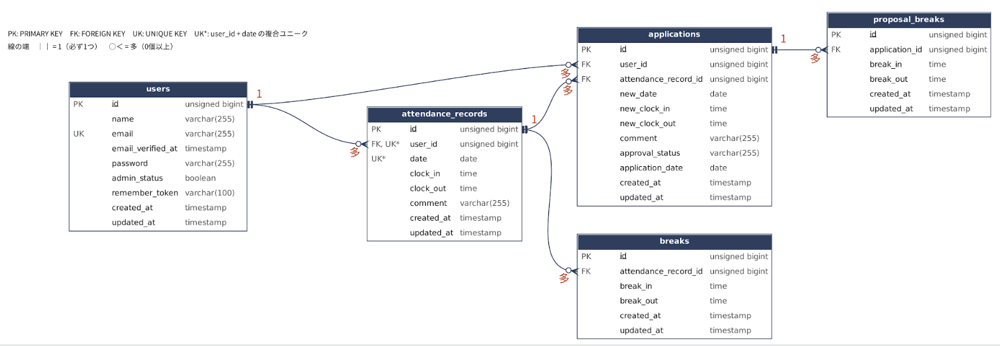

# 勤怠管理アプリ

## 環境構築

### Docker ビルド
1. `git clone https://github.com/momo888-y/attendance-app.git`
2. `cd attendance-app`
3. 依存パッケージをインストール
   ```bash
   docker run --rm -u "$(id -u):$(id -g)" -v "$(pwd):/var/www/html" -w /var/www/html laravelsail/php82-composer:latest composer install --ignore-platform-reqs
   ```
4. `cp .env.example .env` を実行し、`.env` を以下のように設定
```
DB_CONNECTION=mysql
DB_HOST=mysql
DB_PORT=3306
DB_DATABASE=laravel
DB_USERNAME=sail
DB_PASSWORD=password
MAIL_MAILER=smtp
MAIL_HOST=mailpit
MAIL_PORT=1025
```
5. `./vendor/bin/sail up -d`

### Laravel 環境構築
1. `./vendor/bin/sail artisan key:generate`
2. `./vendor/bin/sail artisan migrate --seed`
3. `./vendor/bin/sail npm install`
4. `./vendor/bin/sail npm run dev`

## テスト
`./vendor/bin/sail artisan test`
（テストは testing データベースを使用します）

## 使用技術
- PHP 8.2 / Laravel 10
- MySQL 8.4
- Laravel Sail（Docker）/ Fortify / Vite
- phpMyAdmin / Mailpit

## URL
- アプリ：http://localhost
- 管理者ログイン：http://localhost/admin/login
- phpMyAdmin：http://localhost:8080
- Mailpit：http://localhost:8025

## ログイン情報（ダミーデータ）
| 権限 | 名前 | メール | パスワード |
|---|---|---|---|
| 一般 | 山田 太郎 | user1@example.com | password |
| 一般 | 佐藤 花子 | user2@example.com | password |
| 管理者 | 管理者 一郎 | user3@example.com | password |

## ER 図
